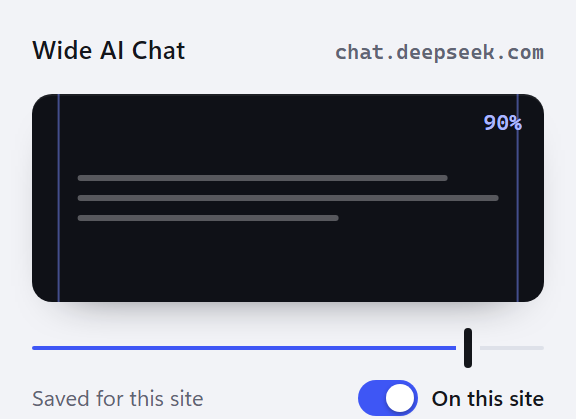

<div align="center">

# Wide AI Chat

**Your AI writes twelve sentences. Chrome shows them eight words wide.**

A tiny Chrome extension that lifts the `max-width` cap on AI chat panels —
no per-site selectors, nothing to fix when ChatGPT redesigns.


<br>



</div>

---

ChatGPT, Gemini, DeepSeek and friends all wrap the conversation in a centred
column capped around `48rem`. On a wide monitor that leaves half the screen
empty and turns every answer into a tall, narrow ribbon. Wide AI Chat finds that
column and moves the cap to where *you* want it, per site, live.

## Install

1. Open `chrome://extensions`
2. Toggle **Developer mode** (top right)
3. **Load unpacked** → select this folder
4. Pin **Wide AI Chat**, open a chat site, click the icon, tick **On this site**

## Use

| Control | What it does |
| --- | --- |
| **On this site** | The opt-in. Off on every site until you tick it; nothing is ever applied without this. Remembered per hostname. |
| **Slider** `30–100%` | Column width as a share of the window. Saved per hostname, applied live. Dragging it while the site is off turns the site on. |

Unticking is the reset: the extension's stylesheet is dropped, so the page is back to stock instantly — no reload.

## How it works

Geometry, not selectors. A column is any box whose *own* cap is what squeezes it:

```text
centred box, capped by itself
  ├─ max-width ≥ 320px and narrower than the window   (skip crumbs and full-bleed)
  ├─ rendered width within 60px of that cap            (the cap actually binds)
  ├─ centred in its parent (±48px)                     (not a sidebar)
  └─ taller than 40px                                  (not a button)
        → max-width: Nvw !important
        → side padding 16px, when the layout pads >20px instead
```

Inside an already-matched column the rules relax, because nested caps are that
turn's own gutter: centring is dropped (Gemini offsets each turn by an avatar
gutter) and a fixed px `width` counts as a cap too, replaced with `width: auto`.

If nothing passes the centred test at all, the widest capped block holding the
thread becomes the anchor — DeepSeek aligns its conversation to the left.

Some sites never cap at all and centre with **symmetric padding** instead
(DeepSeek: `padding-inline: calc((100% - var(--message-list-max-width)) / 2)`).
A tall band padded >40px on both sides is detected as a column and trimmed to
16px, which is the whole fix there.

New markup is checked as it arrives — streamed turns, messages re-mounted while
scrolling, SPA navigation — plus full rescans at 0.9s and 3s, on resize, and
whenever you move the slider.

## Files

| File | Role |
| --- | --- |
| `manifest.json` | MV3 shell: `storage` permission, popup, content script on `<all_urls>` |
| `content.js` | Detector, overrides, per-site state — the whole extension |
| `popup.html` / `popup.js` | Per-site opt-in, width slider and a live column preview; talks to the tab's content script |
| `test.js` | Node self-check: detector, opt-in and reset |
| `debug.js` | Paste-in-DevTools dump, for showing me why one site resists |
| `assets/popup.png` | The popup screenshot above |

## Build

Nothing to install: `.github/workflows/build.yml` runs `node test.js`, then zips the
four runtime files (`manifest.json`, `content.js`, `popup.html`, `popup.js`) as
`wide-ai-chat-<manifest version>.zip`.

- every push to `main` uploads that zip as a workflow artifact
- pushing a tag `v<version>` attaches it to a GitHub release

The tag has to equal the manifest version (`v1.7.2` ⇄ `"version": "1.7.2"`), so a
release can never ship a stale number.
## Test

```console
$ node test.js
ok — detector + opt-in + reset, 25 cases
```

## Privacy

Widths live in `chrome.storage.sync`, keyed by hostname. No network requests, no
analytics, no reading of message content — the script only compares layout
numbers and sets CSS. Off by default everywhere: it touches nothing until you tick
that site on, so non-chat pages are left alone entirely.

## Known limits

- Caps expressed in `%` are left alone — they already scale with the window.
- `flex-basis` caps are not touched; that needs a real selector.
- A centred, capped *card* that isn't chat (welcome panel, modal) can widen too.
  **Untick On this site** or a reload restores it instantly.
- Tables keep their own horizontal scroll, on purpose.
- Unticking drops the extension's stylesheet outright, so the page is exactly stock — there is no per-element undo to get wrong (sites rewrite their own inline padding, so snapshots of it go stale).

## Licence

MIT — see [LICENSE](LICENSE). Do what you want with it.

## One site still resists?

DevTools on that tab → **Console** → paste [`debug.js`](debug.js). No
element-picking: it copies a table of every capped, fixed-width or heavily
padded box on the page with the numbers the detector reads — `maxWidth`,
`width`, the off-centre offset, and whether the extension had already touched
it (`ours`).
